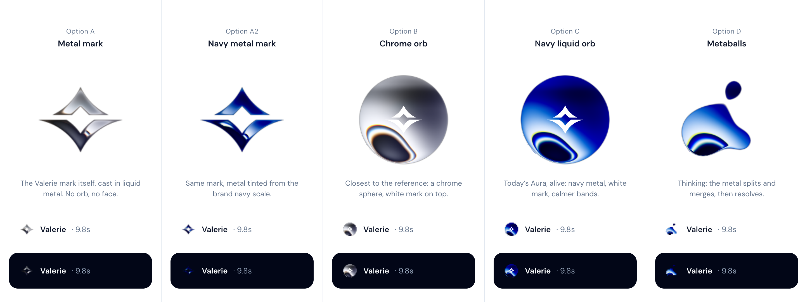

# Aura and the calm canvas: plan

- **Status:** revised 27 Oct 2026. Phases 1–8 are done, with the 2.4 dock (3.2 not needed so far). Phase 9: Aura is the liquid-chrome hexagon with a face, and speaks; its open choices are in `docs/STATUS.md`.
- **Deviations:** every value beyond the Valerie DS is tracked in [DS-DEVIATIONS.md](DS-DEVIATIONS.md).
- **Two references:**
  - **Adam Perlis** for the process and the signature material.
  - **Basit A. Khan** for the overall feel: calm, minimal, strongly positioned.

## The one line

> Leadership leaves convinced Valerie is a world-class analyst, and remembers one thing about it: Aura, in liquid metal, on a calm canvas.

Every decision below is checked against it. Confirm it or rewrite it.

---

## 1. Reference A: Adam Perlis (process and signature)

**Sources:** [adamperlis.com](https://adamperlis.com/), screenshotted at 1440×900, and [How I built this](https://adamperlis.com/how-i-built-this/).

**What we take from it:**
1. **One signature material.**
   - Paper's liquid-metal shader is the only rich thing on the page, and it travels: terminal → "A" → ball → dial knob → Buddy.
   - Everything else is white space, small type, and black and grey.
2. **A character with seats, not a chat dock.**
   - Buddy flies to a seat each section keeps for him, says one line, and moves on. He never covers content.
   - His chat-dock version was dropped as "like every other AI widget".
3. **Two-tone text:** words turn black as they're spoken, and the rest of the line waits in grey.
4. **Quiet chrome:**
   - small, white, round buttons;
   - one primary action per screen;
   - every screenshot on the same grey mat.
5. **Motion on one clock, measured:** the menu went from 2 dropped frames in 3 cycles to 3 in 15.
6. **Robustness:**
   - still-image fallbacks for every shader;
   - fewer than 16 WebGL contexts;
   - shapes processed ahead of time.

**Shader settings, read from the site's bundle.** The hero uses repetition 1.4, softness 0.85 and distortion 0.05. Paper's defaults are 2, 0.1 and 0.07, with contour 0.4, angle 70, and shiftRed and shiftBlue at 0.3. His morph between shapes is a custom shader built on precomputed distance fields, and it took three rebuilds.

**How he worked.** We adopt all of it:
- The reference beats anyone's opinion.
- Choose by eye from A/B/C.
- A screenshot plus one line is the best bug report.
- Measure before fixing.
- Keep a build log.
- Put big ideas behind a switch.

## 2. Reference B: Basit A. Khan (the overall feel)

**Source:** [video of three app screens](https://x.com/basit_designs/status/2113661090525782090), 23 Oct 2026. It is 13s long; I studied it frame by frame at 4K, with colours sampled from the frames.

**What makes it look calm yet strongly positioned:**
1. **One calm canvas.** The whole screen is one cool light grey (`#eff1f3`). Nothing decorates it: no gradients, dots or patterns.
2. **White means "you can touch this".** The composer, the sheet and the round back button are white on the grey. Hierarchy comes from tone, not borders, and there are almost no visible borders.
3. **Emptiness as confidence.** The empty state holds three things: the orb, the question and the composer. Everything else is pushed to the edges: back at top-left, avatar at top-right, composer at the bottom.
4. **The question is quiet.** It's centred, two lines, medium weight, set in grey rather than black, with tight tracking.
5. **The positioning is loud.** The marketing screen has a heavy, tight, near-black headline with one accent word, small grey supporting text and nothing else. There are only two type levels.
6. **One colour moment per screen.** It's the orb, or the iridescent ribbon. Everything else is greyscale.
7. **One black primary button**, full width, about 14px radius.
8. **The composer is one object.** A white card holds the suggestion chips (grey pills, inside the card), the input, and a settings row on a slightly darker band. The suggestions belong to the composer; they aren't tiles on the page.
9. **Nested radii stay consistent:** about 24 on the outer card, 16 on the inner field and 10 on the chips.
10. **Slow, continuous motion.** The orb's soft violet-blue bands swirl on a loop of about 12s, with no bounce. It reads as alive, not busy.

**Our screens against it, at 1440×900 today:**
- **Home:** white page with a dotted radial pattern and halo, orb with an orbit ring, stats line, composer mid-page, then six bordered tiles with icon boxes. That's many stacked boxes.
- **Chat:** a white page where every element draws its own border (the highlights box, the composer), and a grey user bubble.

**The same ideas at desktop width:**

| Basit (mobile) | Valerie (desktop, 1440) |
|---|---|
| Grey canvas | `--canvas` = `--muted` (slate-100, within a hair of `#eff1f3`); dark = `--background` |
| White = interactive | Composer, header buttons, user bubble, key-figure strip and chart cards are white on the canvas, with no borders |
| Orb + quiet question, centred | Aura + the existing headline, centred in the space above the composer |
| Composer docked at the bottom, chips inside | The same, on the 720 column; the six starters become chips inside the composer |
| Round white back button, avatar top-right | View traces, Chats and New chat as white pills, top-right, no bar |
| One black primary | Send turns `--primary` when there's text; New chat stays white |
| One colour moment | Aura is the only colour on Home; on Chat, the data colours stay in the figures and charts |
| Grey mat (Adam) | Comes free: white chart cards sit on the grey canvas, and the card itself is unchanged |

---

## 3. Take, adapt, leave

| | From | For Valerie |
|---|---|---|
| Take | B: calm grey canvas, white surfaces, no borders | Phase 1 foundation |
| Take | B: composer as one object holding the suggestions | Home composer |
| Take | A: liquid metal as the one signature material | Aura, cast in metal |
| Take | A: seats the character moves between | Home hero → answer header → composer dock |
| Take | A: two-tone text in time with the character | The lead turns muted → foreground as Aura speaks |
| Take | A: stills, a context budget, measured motion, a lab with sliders | Same |
| Adapt | B's frosted orb | Calm tuning for the metal (high softness, slow flow), plus a frosted option in `/lab` |
| Adapt | A's Buddy face | No face: the Valerie mark is the character |
| Adapt | B's loud headline with one accent word | Our existing headline stays; Aura is the accent, so no new colour on words |
| Leave | Voice, jokes, Buddy's lines, B's marketing copy | Rule 5: no invented copy |
| Leave | Three.js, page transitions, monospace | Not needed / fragile / rule 3 |
| Leave | Sound on by default | URL-only, optional |

---

## 4. The bot: what Aura looks like

**Recommendation: A2, the Valerie mark cast in navy liquid metal, tuned calm.**
- **It is the brand.** It holds up at 28px, where the orb options (B, C) turn to noise.
- **No new colours.** The tint is `--brand-400` in light and `--foreground` (chrome) in dark.
- **Calm tuning, from reference B.**
  - Softness goes up toward Adam's hero value (≈0.6–0.85), distortion and speed go down, and the loop is slow (≈12s, like Basit's orb).
  - On the grey canvas, Aura is the screen's one colour moment.
- **Option E in `/lab`:** a frosted orb in the spirit of Basit's (a soft brand-scale gradient, blurred, slowly swirling), so you can compare by eye.

| State | Shape | Motion (starting values, tuned in `/lab`) | Seen in |
|---|---|---|---|
| idle | mark | slow flow, speed ≈0.2 | Home hero |
| listening | mark | flow quickens (≈0.5) while you type | Home hero, dock |
| thinking | metaballs | melts, splits and merges (≈1.0) | latest turn header, dock |
| speaking | mark | re-forms, then pulses on the word clock | turn header while the lead streams |
| done | mark | eases to a stop over 600ms, then swaps to a still | settled turns |
| error | mark | stops; tint → `--muted-foreground`; existing red dot | failed turn |
| offline | mark | still, muted | Home |

## 5. Seats: where Aura lives

1. **Home hero** (≈120–144px), centred above the headline. Replaces today's orb, halo and orbit ring.
2. **The flight:**
   - on send, Aura flies from the hero seat to the first turn's 28px header seat, taking about 700ms with a slight settle;
   - it melts into the thinking shape on the way.
3. **Turn header** (28px): live only on the latest turn, while thinking or speaking; stills everywhere else.
4. **Composer dock** (optional): while Valerie works and the live seat is off-screen, Aura sits at the left of the composer.
5. **Drawers:** stills only.

**WebGL budget:** at most 2 live canvases on Chat and 1 on Home.

---

## 6. Build phases

Each phase ends with:
- `npm run build`;
- a check at 1440×900 in light and dark;
- a short report with a URL.

### Phase 1: the calm canvas and the material (in progress)

**1A. Canvas and surfaces (from Basit)**
1. **Tokens.** Add `--canvas` and `--surface` as aliases of `--muted` and `--card`, so no new colours.
2. **Shadows.** Fold the 9 one-off shadows into `--shadow-hairline` and `--shadow-float`.
3. **Canvas.** Home and Chat sit on the canvas; the host stand-in bar stays as it is.
4. **Surfaces.**
   - The composer, user bubble and key-figure strip become white on the canvas, with no borders.
   - The chart cards are unchanged and now sit on the grey.
5. **Header.**
   - The bar goes.
   - View traces, Chats and New chat become white pills in the top-right corner, with the float shadow.
   - Hard rule 1 is updated to match.
6. **Home composition.**
   - Aura and the headline sit centred in the space above the composer.
   - The composer docks at the bottom of the 720 column, with the six starters as chips inside it.
   - The dotted radial pattern, halo, orbit ring and tiles go.
7. **One primary.** Send fills with `--primary` once there's text. Everything else is white or ghost.
8. **Before screens** in `docs/aura/before/` (Home, chat, chart, working, light and dark), in place of a `?look=classic` switch, which would have meant keeping two versions of every component.

**1B. The material (from Adam)**
1. Add `@paper-design/shaders-react`, pinned to 0.0.81. (0.0.82 is 4 days old.)
2. Pre-process the mark into `public/aura/mark-liquid.png` once, by script, from the existing mark paths.
3. Build an `AuraMetal` component with state presets in `src/lib/aura.ts`. Colours are read from CSS tokens at runtime, so components contain no hex.
4. Add stills for each state and theme. They are used for settled turns, drawers, reduced motion and browsers without WebGL.
5. Lazy-load the shader chunk. Pause it off-screen. Show the still under reduced motion.
6. Build `/lab`: live sliders, options A2, A and E side by side, and a "Copy preset" button.

**Exit:** Home and Chat on the calm canvas, with Aura idle in A2-calm, in light and dark.

### Phase 2: seats and the flight
- 2.1 ✓ Home hero seat; Aura listens (flows faster) while you type.
- 2.2 ✓ The flight from Home to the first turn (`AuraFlight`): a small lift, then across early and down late with a 40px hump, so Aura clears the header text and drops onto its seat; 760ms. The seat is re-measured every frame, so the answer rising in can't make it miss. No new dependency. Verified frame by frame on a fake clock.
- 2.3 ✓ Turn seats: live only on the latest turn while thinking or speaking, stills elsewhere.
- 2.4 ✓ Composer dock: while the latest turn works and its Aura is out of view (above the pills or behind the composer), Aura forms at the left of the composer, next to the persona and opposite Stop. It melts out when you scroll back or the answer lands.

### Phase 3: the morph
- 3.1 ✓ **v1:** the outgoing shape melts outward (scale up, blur, fade) while the incoming one gathers in, over 600ms.
  - **Thinking shape:** a single liquid drop (the shader's circle, distortion 0.2), not metaballs. Metaballs at 28px read as a lumpy blob with a stray droplet. The drop keeps a calm silhouette while its bands churn, so it also ties to reference B's swirling orb.
  - **Where it plays:** work starts (mark → drop); the answer arrives (drop → mark, picking up from the working view's drop); and in flight (Aura leaves Home as the mark and lands as a drop).
  - **Sizing:** size follows the shape, not the state, so nothing jumps mid-morph.
  - **Checked:** frame by frame, light and dark, with the CSS animations paused and stepped on a fake clock.
- 3.2 **v2** (a forked shader with a distance-field morph): not needed so far. Revisit only if the crossfade reads as a crossfade on a big screen.

### Phase 4: speaking in time
- 4.1 ✓ **One clock:** the same word clock (`WORD_MS`) streams the lead and gives Aura its beat: one small swell per clause spoken (words ending in punctuation). Per-word pulses at 38ms would read as a tremble.
- 4.2 ✓ **Two-tone lead (default):** the full headline is laid out in grey (`--muted-foreground` at 45%), and each word turns to ink as it's spoken, with no reflow. It's readable from the first frame. The old blur-in stays behind `?lead=blur` for comparison.

### Phase 5: the rest of the quiet pass
- 5.1 ✓ **Steps panel:** no box. The expanded steps sit under "Valerie" (indented 38px); the list's own connector line is the hairline. "Open full trace" sits under the list. The error state keeps its card, because there the steps are the content.
- 5.2 ✓ **Spacing:** 16px from the header to the lead, 24px between sections (strip, blocks, follow-ups), 12px for tight pairs (offer → chips), 32px before the chart, 64px between turns.
- 5.3 ✓ **Type:**
  - 13px is gone: header pills, the steps pill, key-figure labels and topic chips are now 14px.
  - Left as they are: 11px avatar initials (a glyph in a 24px circle) and the host's 10px badge.
  - Tight tracking only on the 22, 28 and 36px sizes.
  - Grey text on the canvas now passes AA, at 5.32:1 (was 4.34:1) (D16).
- 5.4 ✓ **Radii:** the persona menu's rows nest at 6px inside its 12px corner. The rest already followed 24 (composer; 20 since 27 Oct, buttons inside at 10) / 16 (cards) / 12 (menus) / 8 (buttons) / full (pills and chips).
- 5.5 ✓ **Dark mode:** steps, Home, the persona menu and the Chats drawer were checked.
- Also fixed: the lens badge was invisible on the canvas (`--muted` on `--muted`). Neutral badges now use an ink tint (`--foreground` at 6%), which reads on both grey and white.
- 5.6 ✓ **Say it once** (after review):
  - **Home starters:** lens tabs, each an icon and a word: All (the default, all six in the analyst's order), Industry, Competitive, Brand. The questions are plain rows with no icons; the tabs carry them. No card fill: everything sits on the canvas, inside a hairline frame (`--border`) that is solid at the top and fades out down the sides. The frame keeps the height of "All" on every tab. White marks only the selected tab and the row under the pointer.
    - Switching tabs never moves the page: the space for "All" stays reserved.
    - Arrow keys move between tabs.
    - "All" is draft copy in `ui.ts`.
  - **Chats:** rows are the title only; the repeated icon and lens are gone.
  - **Traces:** grouped by day like Chats; the identical "Answered" badge and the stacked boxes are gone.
  - **Pinned list:** the repeated pin icon is gone; the heading carries it.
  - **Ranked list:** plain numbers, with numbers, names and values on the first line's baseline.
  - **Drawers:** row text lines up with the heading, and the hover fill bleeds past it.

### Phase 6: sound ✓
- **Four cues,** synthesised with Web Audio (no files, `src/lib/sound.ts`):
  - **send:** a rising glide as Aura takes off;
  - **step done:** the faintest tick;
  - **answer forms:** two notes a fifth apart;
  - **error:** a soft fall.
- **Off by default:** a meeting room shouldn't be startled, and browsers block audio until the first click anyway.
- **Turning it on:** the speaker pill (icon only; draft label and tooltip in `ui.ts`), or `?sound=1` on any link. The choice is remembered.

### Phase 7: quality gates ✓
Measured on the production build (`vite preview`), headless Chrome 156 on the real GPU (Apple M3, Metal), 1440×900 at 2× (Retina).

- **Frames.** Target: 0 dropped frames in 10 sends from Home (flight, morph, steps, two-tone lead, chart).
  - **Before the fix:** 30 dropped in 10 sends (about 5,150 frames), and a 350ms hitch on the first send.
    - The cause was canvas creation, not drawing.
    - Each new shader canvas cost ~15ms: context 4ms, shader compile 6ms, mask upload 5ms.
    - A send made six of them: two in flight, two hidden under the flight, and two as the answer formed.
  - **The fix:** a canvas pool in `AuraMetal`, with Paper's own `ShaderMount`.
    - A melted or departing Aura parks its canvas off-screen, already compiled. It is paused while parked, so it costs nothing.
    - The next Aura of that shape picks it up, the canvas closest in size first.
    - Two drops are warmed and drawn once while Home sits idle.
    - The drop shape skips the mask upload, since it never reads the mask.
    - A seat hidden under the flight starts in its final shape instead of morphing unseen.
  - **After:**
    - 0 dropped in sends 2–10, with 0 canvases created per send.
    - The first send in a fresh tab misses one frame (33ms). It's first-render page work, not the shader: it stays when the shader work is warmed ahead.
    - Total: 1 in 5,294 frames.
- **Cost.**
  - Drawing: ~800 shader frames cost ~1ms of main-thread time in total.
  - WebGL contexts per session: 4 (the hero, two warmed drops, the support check). Before the fix it was 6 per send.
  - On-demand shader chunks: 13.2 kB + 20.4 kB (4.3 + 6.5 kB gzipped).
  - Images: mask 132 kB, stills 18 + 16 kB.
  - The main bundle (667 kB, 198 kB gzipped; mostly the charts library) predates this work.
- **Browsers** (Playwright's builds of each engine, headless, on this Mac):
  - **Chrome 156:** as above.
  - **WebKit 27.2** (Safari's engine):
    - WebGL2 on the Apple GPU; the flight, morph, two-tone lead and dark mode all render; no errors.
    - 0–2 late frames per send (27–31ms), at the moment the answer swaps in.
  - **Firefox 157:**
    - The same checks pass, with no errors.
    - 0 dropped frames on 4 of 5 sends; one send had 6, the worst 50ms.
  - **Still to do by hand:** a minute in the real Safari app. Sending a starter covers it. Safari can't be scripted here without turning on its Remote Automation setting.
  - No view transitions are used, so Safari's frame pause there doesn't apply.
- **States**, all with no console errors:
  - **Reduced motion:** stills only, no canvases; the flight is skipped.
  - **WebGL off:** stills only.
  - **Offline:** the strip shows on Home and in the chat.
  - **Dark mode:** working and answer screens checked.
  - **`?shell=dashboard`:** Aura flies inside the host frame and lands in the header.
  - **`/lab`:** the looks and capture mode still work with the pool.
- **Motion review against the 12 principles:**

| Principle | Where it shows | Verdict |
|---|---|---|
| Squash and stretch | The beat (1.12× per clause); melt (1.14× out) and form (0.82× in) | ✓ |
| Anticipation | The 4px lift at 1.06× before the flight | ✓ |
| Staging | One mover at a time: the flight lands before the steps tick; lead, then body, then chart | ✓ |
| Straight ahead / pose to pose | Pose to pose between mark and drop; the metal itself flows straight ahead | ✓ |
| Follow-through and overlap | The melt and form overlap; the chart lands after the body | ✓, but the landing has no settle (see below) |
| Slow in, slow out | Ease-out across, ease-in-out down; custom curves on melt and form | ✓ |
| Arcs | The 40px hump on the flight | ✓ |
| Secondary action | The metal flows faster while listening, thinking and speaking | ✓ |
| Timing | Flight 760ms, morph 600ms, beat 380ms; step timing comes from the data | ✓ |
| Exaggeration | Kept low on purpose: an analyst, not a mascot | ✓ |
| Solid drawing | The bands follow the mark's contour; the drop keeps its volume at 0.7× | ✓ |
| Appeal | The character is the brand mark itself | ✓ |

  - **Open, optional:** a small settle when Aura lands on its seat, as follow-through. It is not built, because it's a new motion you haven't seen.

### Phase 9: Aura becomes a guide (face, voice, lines)
This reverses the first plan's "no face, no voice" call: Buddy's face, voice and guiding are the heart of reference A.
- 9.1 **Chosen: Hexagon · Liquid chrome** (26 Oct 2026): the polished hexagon's outline (point up, soft pinched sides, no kinks) cast in Paper's liquid metal, classic chrome. It replaced Cloud · Liquid chrome, chosen the day before ("not looking good" in the product).
  - **Kept for leadership** in `/lab?view=character`: Cloud · Liquid chrome (with its round bottom), Constellation, Hexagon · Polished chrome, Cloud · Soft. The chosen hexagon sits first, marked "In product".
  - **Dropped:** Hexagon · Dark film, the first Hexagon · Liquid chrome (a sharper hexagon outline), Cloud · Polished chrome.
  - **Switching shape** is one line (`AURA_SHAPE` in `src/lib/aura.ts`), plus its still (`public/aura/<shape>-still.png`, from `/lab?capture=light&shape=<shape>`).
  - **Shared rig:** blink, gaze (pointer, or the expression's own look), idle float, six expressions, and a voice ring and squash driven by the recording's loudness.
- 9.2 **In the product (done):**
  - **Aura is the hexagon everywhere:** Home hero, flight, answer seats, working, the composer dock, the error header. One shape, so the mark-to-drop morph is gone; thinking shows in the eyes (they look up and squint) and the chrome (faster, more distortion).
  - **Settled seats are a still** (frame 6750: a light face, no dark shape under the eyes that reads as a mouth) with live eyes on top, so a long thread costs no extra canvases.
  - **Small sizes:** the chrome shape is drawn larger than the mark was (scale 1.1) and the eyes grow 1.3× below 40px, with a pale rim so they read where a dark band passes.
  - **Home:** with sound on, Aura says the tagline once per visit, each word inking as it's said. It looks down at the composer while you type.
  - **Answer:** with sound on, Aura reads the new headline; the ink follows the voice instead of the word clock, then the latest answer says the follow-up offer. The body still arrives on the visual clock, so nothing waits on the voice.
  - **Error:** a concerned face, grey, with the red dot. Not spoken: the error line names Valerie in the third person.
- 9.3 **Voice (done):** six built-in macOS voices, all eight lines each, in `public/voice/<voice>/`. Nicky by default; `?voice=` switches. Played through Web Audio on the context the send cue unlocked (Safari blocks a late `<audio>` start). Off until the speaker pill or `?sound=1`.
  - **Better voices, same pipeline:** download a free "Premium" voice in System Settings → Accessibility → Spoken Content, or use a paid voice service with your key.
- 9.4 **Copy:** no greeting line was added; the tagline is the greeting. New DRAFT strings: Aura's tap labels (`voiceCopy`).
- 9.5 **Tap Aura** to hear its line (the tagline on Home, the headline in an answer), or to stop it. Works with sound off, since it's an explicit tap.
- 9.6 **Two versions (27 Oct):** after a leadership review, both mascots are built into the product for comparison: Version A at `/` (Hexagon · Liquid chrome), Version B at `/constellation/` (Constellation). Then, from leadership feedback ("not human"), B became abstract: no eyes, and every state a form the points ease into (`Constellation.tsx`). Thinking loops through data forms, a new one every 3.2s, like Claude's spinner changing on a long reply: orbit (a comet spinner below 64px), wave, bars, scatter, scan. 17 bigger points below 64px, tone by distance from the centre (lighter on dark). B's wait is two-stage: Aura and a shimmering step line first, the skeleton only for the last 2.5s. SVG only, so no still and no shader: it stays live at every size.
- **Open:** pick the voice (Nicky is a placeholder choice); whether settled seats should keep following the pointer.

### Phase 8: for the leadership room
- 8.1 **Before/after (done, 27 Oct):** six 16:9 slides in `docs/aura/slides/` (Home, Answer, Chart, Working, Home and Answer in dark), pairing `docs/aura/before/` with `docs/aura/after/`, shot at the same URLs, size (1440×900) and framing.
- 8.2 **README (done):** every URL in the table opened with no console errors (15 of 15); a "For the leadership room" section points to the slides and `docs/STATUS.md`. The voice and hexagon were also checked in WebKit (Safari's engine): same ink-on-voice timing, no errors.
- 8.3 **Video (done):** `docs/aura/valerie-demo.mp4`, 28.5s, 1920×1200, 60fps, H.264 with AAC, 14.8MB. One send from Home: the pointer glides in and the eyes follow it, sound on and the greeting, the Brand tab, "Hear it from the buyers", the flight, working, the headline read aloud as it inks, then the thread eases down to the follow-up offer and its chips as Valerie asks.
  - **How:** the production build is captured frame by frame on a virtual clock (`tools/video/clock.js`: timers, animation frames, CSS and Web Animations, and the audio clock all advance only between frames), so every frame is exact whatever the machine's speed. A drawn cursor shows the clicks. The voice clips are laid in at the moments they were spoken (`tools/video/encode.swift`, AVFoundation; no ffmpeg needed).
  - **Checked** in AVFoundation (as QuickTime and Keynote read it): 60fps video and the sound track, frames decoded at 1, 5, 8.3, 19.5 and 27.5s.

---

## 7. If time runs short

- **Must have:** Phase 1; 2.1–2.3; 4.1.
- **Nice to have:** 3.1, 4.2, Phase 5.
- **Stretch:** 2.4, 3.2, Phase 6, 8.3.

## 8. Rules this touches (CLAUDE.md)

- **Rule 2 (tokens).**
  - `--canvas`, `--surface` and the two shadows are ledgered.
  - The canvas and surface are aliases of DS colours, so there are no new colour values.
- **Hard rule 1 (44px bar).** The bar becomes floating pills in Phase 1, and the rule text is updated with it.
- **Rule 4 (chart cards).** Unchanged. They now sit on the grey canvas, which does the grey mat's job.
- **Rule 5 (copy).** Starter chips reuse the existing starter titles, so no new strings.

## 9. Open decisions

1. **Bot:** A2-calm (in progress) or E (frosted)? You can judge them side by side in `/lab`.
2. **Deviation budget** in the ledger: OK?
3. **Sound:** skip (recommended) or URL-only?
4. **Paper:** open Paper Desktop if you want to tune the metal in Paper.
